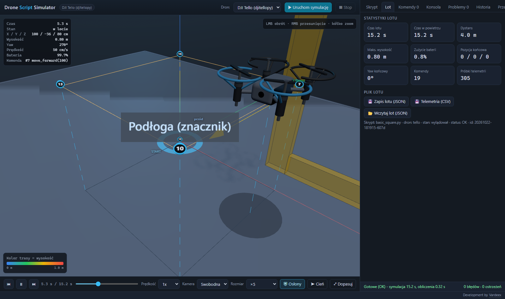
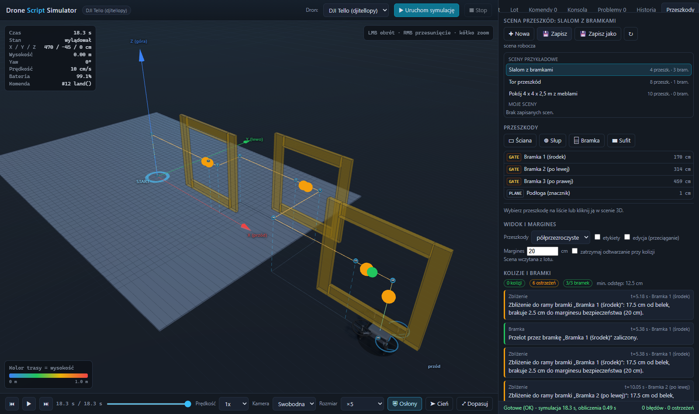

# Drone Script Simulator

[](https://github.com/Vardeex/drone-script-sim/actions/workflows/tests.yml)

> **Status: prototyp / wersja rozwojowa.** Model 3D drona jest w trakcie dopracowania,
> biblioteka `dronemoves` była testowana tylko w symulacji, a parametry sterowania RC
> to założenia, nie pomiary z prawdziwego drona.

> **Nowy tutaj?** Zacznij od **[docs/PORADNIK.md](docs/PORADNIK.md)** - krok po kroku
> od instalacji do pierwszego lotu i przejścia na prawdziwego Tello.

Lokalna aplikacja do **testowania skryptów sterujących dronem bez drona**.
Wgrywasz skrypt Pythona (na razie dla DJI Tello przez `djitellopy`), aplikacja
uruchamia go w sandboxie (symulacja, bez łączenia z siecią) i pokazuje w 3D
lot, trasę, telemetrię, komendy, błędy i ostrzeżenia.



## Funkcje

* wgrywanie skryptów `.py` (plik, edytor w przeglądarce, przykłady),
* uruchamianie w **osobnym procesie** z podstawionym **mockiem `djitellopy`**,
  blokadą sieci, wirtualnym zegarem i limitem czasu (60 s),
* model 3D quadcoptera (korpus, 4 ramiona, wirniki), podłoże z siatką 1 m,
  osie X/Y/Z, punkt startu,
* trasa kolorowana wysokością + legenda, pionowe linie wysokości,
  znaczniki każdej komendy z numerem i dymkiem (komenda, argumenty, pozycja,
  wysokość, yaw, bateria, czas, linia skryptu),
* odtwarzanie: play/pauza, suwak czasu, prędkość 0.25x–8x,
  poprzednia/następna komenda, kamery: swobodna / śledząca / z góry,
* panel boczny: tabela komend (klik = skok w czasie), telemetria na żywo,
  konsola stdout/stderr, lista błędów i ostrzeżeń z numerem linii,
  statystyki lotu (czas, dystans, maks. wysokość, zużycie baterii),
* podgląd skryptu z podświetleniem aktualnie wykonywanej linii,
* zapis/wczytanie lotu (JSON), eksport telemetrii do CSV, historia lotów,
* interfejs w języku polskim, działa offline (three.js jest lokalnie),
* **przeszkody 3D** (funkcja dodatkowa, wyłączalna): edytor scen, kolizje
  i zbliżenia liczone na całej telemetrii, przeloty przez bramki - patrz
  „Przeszkody 3D” niżej.

## Przeszkody 3D

Funkcja pokazuje, czy skrypt **rozbiłby drona**: rysuje przeszkody w scenie,
sprawdza cały lot i oznacza kolizje, zbliżenia poniżej marginesu oraz
zaliczone przeloty przez bramki. Przeszkody **nie zmieniają przebiegu
symulacji** - dron się nie odbija i nie zatrzymuje; symulator ma pokazać, że
skrypt by się rozbił, a nie poprawiać lot.



### Jak używać edytora

Zakładka **Przeszkody** w panelu po prawej (jest tylko wtedy, gdy funkcja jest
włączona):

1. Wybierz scenę z listy (przykładowe z `scenes/` albo własne z `scenes/user/`),
   albo „✚ Nowa” (pusta scena 4 × 4 × 2,5 m).
2. Dodaj przeszkody: **▭ Ściana** (prostopadłościan), **◍ Słup** (walec),
   **⌸ Bramka** (rama do przelotu), **▬ Sufit** (płaszczyzna - tylko widok).
3. Zaznacz przeszkodę na liście lub kliknij ją w scenie 3D i ustaw nazwę,
   pozycję X/Y/Z, wymiary, obrót (wokół osi pionowej) oraz - dla bramki -
   otwór. Obok pól widać wymiary i **odległość od punktu startu**.
4. Tryb **edycja (przeciąganie)** pozwala przesuwać przeszkody myszą po
   podłożu; „⧉ Duplikuj” / „🗑 Usuń” działają na zaznaczonej przeszkodzie.
5. Widok przeszkód: **półprzezroczyste / pełne / ukryte** + etykiety nazw.
6. **Margines** (domyślnie 20 cm) i „zatrzymaj odtwarzanie przy kolizji”
   są zapamiętywane w przeglądarce.
7. „💾 Zapisz” zapisuje scenę do `scenes/user/<nazwa>.json` (katalog poza
   repozytorium); „💾 Zapisz jako” tworzy nową scenę.

Wybrana scena jest **zapisywana razem z lotem**, więc po wczytaniu lotu
z historii wracają te same przeszkody, znaczniki i lista problemów.

### Wykrywanie kolizji

* dron to prostopadłościan **10 × 10 × 5 cm** obracany kursem,
* do każdej przeszkody dodawany jest **margines bezpieczeństwa** (domyślnie 20 cm),
* sprawdzana jest cała telemetria; między próbkami trasa jest próbkowana
  co 1 cm, żeby szybki przelot nie „przeskoczył” cienkiej ściany,
* **kolizja** - dron dotyka przeszkody: czerwony znacznik na trasie i wpis
  na liście problemów (czas, przeszkoda, komenda i linia skryptu),
* **zbliżenie** - odstęp mniejszy niż margines: żółty znacznik i wpis,
* **odległość od bramki** mierzona jest do **belek ramy** (nie do płaszczyzny
  bramki): przelot przez środek otworu 90 × 90 cm to 40 cm luzu (do krawędzi
  otworu), dron 140 cm przed bramką ma ~139 cm do ramy (najbliższy wierzchołek
  górnej belki), a 10 cm nad ramą dokładnie 7,5 cm. Samo przejście przez
  płaszczyznę ramy nie jest kolizją ani zbliżeniem - liczy się dotknięcie belki,
* **bramka** - zaliczona, gdy dron przeleciał przez płaszczyznę ramy w całości
  w otworze (z 2 cm zapasu od ramy); zahaczenie o ramę to kolizja,
* statystyki lotu: liczba kolizji, ostrzeżeń, zaliczonych bramek i minimalny
  odstęp od przeszkody (dla bramki - od belek ramy).

### Format JSON sceny (`scenes/*.json`)

```json
{
  "format": "dronesim-scene",
  "version": 1,
  "name": "Slalom z bramkami",
  "description": "Trzy bramki 90 x 90 cm",
  "room": [600, 400, 250],
  "obstacles": [
    {
      "id": "gate-1",
      "kind": "gate",
      "name": "Bramka 1 (środek)",
      "position": [150, 0, 80],
      "size": [120, 5, 120],
      "opening": [90, 90],
      "thickness": 5,
      "yaw_deg": 0
    }
  ]
}
```

| Pole | Znaczenie |
|---|---|
| `kind` | `box` (prostopadłościan), `cylinder` (walec), `gate` (bramka), `plane` (płaszczyzna - tylko widok) |
| `position` | środek bryły `[x, y, z]` w cm (dla bramki płaszczyzna ramy jest w `x, y`) |
| `size` | wymiary `[x, y, z]` w cm; dla walca `size[0]` = średnica, `size[2]` = wysokość |
| `opening` | otwór bramki `[szerokość, wysokość]` w cm |
| `thickness` | grubość ramy bramki / płaszczyzny w cm |
| `yaw_deg` | obrót wokół osi pionowej, **dodatni = w prawo** (konwencja Tello) |
| `room` | opcjonalne wymiary pomieszczenia `[x, y, z]` w cm (informacyjnie) |

Przykładowe sceny w repozytorium: `room_with_furniture` (pokój 4 × 4 × 2,5 m
z meblami), `gate_slalom` (slalom z bramkami), `obstacle_course` (tor przeszkód).

### Przykłady

| Plik | Co pokazuje | Wynik |
|---|---|---|
| `examples/obstacles_demo.py` | slalom przez 3 bramki (scena `gate_slalom`) | 3/3 bramki, 0 kolizji, 0 ostrzeżeń |
| `examples/obstacles_crash.py` | za mały zjazd w bok przed bramką 2 | kolizja z ramą bramki 2 |

### Maty Tello EDU (Mission Pads)

Tello EDU rozpoznaje **maty z kodem** (Mission Pad `m1`-`m8`) kamerą dolną i zna
wtedy swoją pozycję względem maty. Symulator odwzorowuje to samo API djitellopy:

| Komenda | Znaczenie |
|---|---|
| `enable_mission_pads()` / `disable_mission_pads()` | włącz / wyłącz wykrywanie (`mon` / `moff`) |
| `set_mission_pad_detection_direction(0\|1\|2)` | kierunek: 0 = kamera dolna, 1 = przód, 2 = oba |
| `get_mission_pad_id()` | numer widzianej maty 1-8, **-1** gdy żadnej nie widać |
| `get_mission_pad_distance_x/y/z()` | pozycja drona w układzie maty (x przód maty, y lewo, z góra) |
| `go_xyz_speed_mid(x, y, z, speed, mid)` | lot do punktu względem maty `mid` |
| `curve_xyz_speed_mid(...)` | lot łukiem do punktu względem maty |
| `go_xyz_speed_yaw_mid(...)` | lot do punktu względem `mid1`, potem nad `mid2` + obrót (`jump`) |

Aby użyć mat: w zakładce **Przeszkody** kliknij **▦ Mata** (albo wczytaj scenę
`mission_pads`), ustaw numer 1-8, pozycję i obrót. Mata leży na podłodze,
nie bierze udziału w kolizjach, a w scenie 3D widać jej numer.

**Zasięg wykrywania jest założeniem modelu, nie pomiarem z drona**: kamera
widzi matę, gdy dron jest nie dalej niż **30 cm** od jej środka i na wysokości
**30-120 cm** nad nią (dokumentacja Tello SDK 2.0 nie podaje dokładnych liczb;
mata ma 30 × 30 cm, a kamera dolna ma szersze pole widzenia). Częstotliwość
ramek 10 Hz. Wartości są w jednym miejscu: `app/features/obstacles/mission_pads.py`.
Komendy `*_mid` wymagają maty **aktualnie widzianej** - inaczej skrypt kończy
się błędem `PadError` (tak zachowuje się prawdziwe Tello).

Przykład: [`examples/mission_pads_demo.py`](examples/mission_pads_demo.py) - przelot
kolejno nad matami 1 → 2 → 1 → 3 → 4 (scena `mission_pads`).

### Kamera „Z drona (FPV)”

Lista **Kamera** ma tryb **Z drona (FPV)**: obraz z kamery umieszczonej w nosie
modelu, z polem widzenia **82,6°** (tyle podaje specyfikacja DJI Tello; pozostałe
tryby używają 50°) i lekkim pochyleniem w dół. Kamera jedzie z dronem w każdej
klatce, więc działa zarówno przy odtwarzaniu, jak i przy przewijaniu suwakiem
czasu. W tym trybie obrót myszą jest wyłączony (kamerą steruje dron) - wróć do
„Swobodna”, żeby znów rozglądać się po scenie. Test przeglądarkowy:
`test_fpv_camera_follows_drone` (pole widzenia, zgodność z pozycją drona,
brak błędów w konsoli).

### Tryb realistyczny (domyślnie wyłączony)

Przełącznik w nagłówku edytora: **Realizm: idealny / realistyczny** + pole
**seed**. Ustawienie zapisuje się w przeglądarce (`localStorage`). Po co: idealny
symulator nie pokazuje, jak skrypt zachowa się na dronie, który dryfuje i ma
niedokładne czujniki. Tryb realistyczny dodaje:

| Element | Założenie (nie pomiar) |
|---|---|
| dryf poziomy | losowy spacer 2-6 cm/s, nowy kierunek co 1 s |
| szum wysokości | ±2 cm (1 σ) w `get_height` / `get_distance_tof` |
| szum kursu | ±1,5° (1 σ) w `get_yaw` |
| opóźnienie RC | nowe wychylenia wchodzą po 100 ms |
| niedokładność `move_*` | ±5 % odległości |
| seed | ten sam seed = ten sam lot (powtarzalność) |

Tryb **idealny** liczy lot bit w bit tak jak dotąd (pilnuje tego test
`test_ideal_mode_is_unchanged`). Zmierzone w trybie realistycznym dla scenariusza
`forward 100 → turn 90° → forward 80 → return_home`: dron kończy **2,9-11,3 cm**
od startu (średnio 7,8 cm z 10 seedów) - czyli `return_home` nadal działa, ale
idealne 0 cm nie jest już osiągalne. Parametry: `app/sim/realism.py`.

## Planer trasy

Zakładka **Planer** (funkcja `route_planner`, włączana w `config.json`) pozwala
zbudować trasę z punktów i wygenerować gotowy skrypt.

* **Dodawanie punktów** - przycisk „✚ Dodaj punkt” (kolejny punkt 100 cm dalej)
  albo tryb „Klik na podłożu” (klik w scenie 3D). Wysokość nowego punktu
  dziedziczy poprzedni punkt, startowo 100 cm.
* **Lista punktów** - edycja X/Y/Z w cm, kurs nosa w punkcie (`po torze`,
  `stały kurs`, `na punkt`, `na start`), zmiana kolejności (↑/↓), wstawianie
  (✚), usuwanie (✕), zaznaczanie i przeciąganie w scenie 3D
  (Shift + przeciąganie = wysokość).
* **Podgląd na żywo** - po każdej zmianie panel pokazuje dystans, czas lotu
  (`eta_s`), zużycie baterii i listę problemów (limity Tello, kolizje z
  przeszkodami z aktywnej sceny).
* **Generowanie** - „▶ Wygeneruj i uruchom” (kod trafia do edytora i startuje
  symulację), „⌨ Pokaż kod”, „📋 Kopiuj kod”, „💾 Pobierz .py”,
  „📥 Wczytaj ze skryptu” (trasa zapisana w bloku `dronesim-route`).

### Tryby generowania

| Tryb | Biblioteka | Charakterystyka |
|---|---|---|
| **Prosta** (domyślny) | `djitellopy` | `go_xyz_speed` + `rotate_*`; dokładny, przewidywalny |
| **Płynna** (eksperymentalny) | `dronemoves` | `pilot.path(smooth=True)`; gładkie łuki, ale może odstawać od punktów |

Tryb „płynna” jest oznaczony w UI jako **eksperymentalny**. Zmierzone
odchylenie od punktów: kwadrat 3,6 cm, wokół przeszkody 13,7 cm,
obroty 10,3 cm, „za plecami” 120 cm (znany problem KI-1 w `KNOWN_ISSUES.md`).
Gdy odchylenie przekracza 15 cm, panel pokazuje ostrzeżenie
„tryb płynny: odchylenie do X cm od punktów” - generowanie nie jest blokowane.

### Przykład: trasa w trybie „prosta”

```python
from djitellopy import Tello

tello = Tello()
tello.connect()
tello.takeoff()

tello.go_xyz_speed(100, 0, 20, 50)      # punkt 1: 100 cm przód, 20 cm wyżej
tello.rotate_clockwise(90)
tello.go_xyz_speed(100, 0, 0, 50)       # punkt 2: 100 cm po nowym kursie
tello.land()
```

### Przykład: ta sama trasa w trybie „płynna”

```python
from djitellopy import Tello
from dronemoves import Pilot

tello = Tello()
tello.connect()
tello.takeoff()                          # dron na 80 cm

with Pilot(tello, speed=50, max_height_cm=500, max_radius_cm=500) as pilot:
    # punkty WZGLĘDNE wobec pozycji drona (0, 0, 0 = tu, gdzie jestem)
    pilot.path([(100, 0, 20), (100, 100, 20)], smooth=True)
tello.land()
```

### Ograniczenia trybu „płynna”

* jedna prędkość na całą trasę (bez prędkości indywidualnych),
* punkt w innym kierunku niż nos drona na starcie nie jest realizowany
  poprawnie (KI-1) - wstaw obrót albo użyj trybu „prosta”.

Długie trasy (punkty ponad 500 cm od startu) i „Wróć do startu” **działają od
2026-10-24** (KI-7): odcinki dłuższe niż 400 cm są dzielone na punkty pośrednie
w tym samym wywołaniu `path`, a powrót robi `pilot.return_home()`. Zmierzone na
trasie `(600, 0) → (600, 100)` + powrót: punkty 0,1 / 0,7 cm, powrót 0,5 cm.

## Punkty rozszerzeń

Funkcje dodatkowe (**wtyczki**) nie są wkompilowane w rdzeń - rdzeń odkrywa je
przy starcie i łączy się z nimi **tylko w tych punktach**:

| # | Punkt | Miejsce w kodzie |
|---|---|---|
| 1 | **Rejestr wtyczek**: manifest `plugin.json` + `router.py` (APIRouter) i `hooks.py`; rdzeń odkrywa wtyczki z `app/features/<id>/` (wbudowane) i `plugins/<id>/` (zewnętrzne), montuje router pod `api_prefix`, statyki pod `/static/features/<id>` i rejestruje hook | `app/features/registry.py`, `app/features/plugin_model.py`, wywołanie `_install_features()` w `app/server.py` |
| 2 | **„Po symulacji przeanalizuj lot”**: jeden hook `register_post_save_hook(fn)`; rdzeń woła go po zapisaniu lotu, dostając zapis lotu i opcje uruchomienia | `src/hooks.py` wtyczki → `app/storage.py` |
| 3 | **Opcje uruchomienia**: pole `options` w `POST /api/run` (i formularz `options` w `/api/upload`) trafia do `storage.save(..., options=...)` i do hooków | `app/server.py` |
| 4 | **UI**: `GET /api/features` zwraca włączone wtyczki; `boot.js` doładowuje panel (`ui.panel`, rejestracja przez `panels.registerFeaturePanel`), warstwę sceny 3D (`ui.scene_layer`, `scene.addOverlayLayer`) i style (`ui.styles`); zakładkę i przycisk rdzeń tworzy sam, jeśli ich nie ma w HTML | `app/static/js/boot.js`, `app/static/js/panels.js`, `app/static/js/scene.js` |
| 5 | **Kamera na trasę**: `scene.frameFlight()` (kadr na całą trasę bez zmiany kierunku patrzenia) i `scene.topDownFlight()` (widok z góry); przycisk „Dopasuj” używa ich, gdy kamera jest swobodna | `app/static/js/scene.js`, `app/static/js/app.js` |

Rdzeń nie importuje niczego z wtyczek poza rejestrem. Wtyczkę można
**wyłączyć jednym ustawieniem** w `config.json` (albo przełącznikiem
w zakładce **Wtyczki** - zmiana działa po restarcie serwera):

```json
{ "features": { "obstacles": { "enabled": false } } }
```

Wtedy znikają jej endpointy (`/api/obstacles/*` → 404), pliki UI nie są
serwowane, a aplikacja działa normalnie. Błąd jednej wtyczki (zły manifest,
błąd składni, wyjątek przy wczytaniu) **nie wywraca aplikacji** - wtyczka
trafia do stanu „błąd” z komunikatem w zakładce **Wtyczki**.

Gotowy wzór: [`plugins/example_hello/`](plugins/example_hello/).
Opis krok po kroku: **[docs/plugins.md](docs/plugins.md)**.

## Wymagania

* Windows 10/11
* **Python 3.11 lub nowszy** (aplikacja sama Pythona nie instaluje)
* nowoczesna przeglądarka z WebGL (Edge, Chrome, Opera, Firefox)

## Instalacja

```bat
git clone <adres-repozytorium> DroneSim
cd DroneSim
setup.bat
```

`setup.bat` tworzy środowisko wirtualne `.venv` w katalogu projektu i instaluje
zależności z `requirements.txt` (wersje przypięte). Instalowana jest też
**biblioteka `dronemoves` z `lib/dronemoves`** (edycyjnie, `-e ./lib/dronemoves`),
więc skrypty w symulatorze mają `from dronemoves import Pilot`. Prawdziwe
`djitellopy` **nie** jest instalowane - sandbox podstawia własny mock.

Jeśli `python` nie jest w `PATH`, wskaż interpreter:

```bat
set PYTHON_EXE=C:\Python311\python.exe
setup.bat
```

Aktualizacja po `git pull` (nowe zależności):

```bat
.venv\Scripts\python.exe -m pip install -r requirements.txt
```

Testy:

```bat
.venv\Scripts\python.exe -m pytest
```

Testy w przeglądarce (Playwright + Chromium, oznaczone markerem `browser`) są
pomijane, gdy Playwright nie jest zainstalowany:

```bat
.venv\Scripts\python.exe -m pip install playwright
.venv\Scripts\python.exe -m playwright install chromium
.venv\Scripts\python.exe -m pytest -m browser
```

### Testy automatyczne (GitHub Actions)

Plik [`.github/workflows/tests.yml`](.github/workflows/tests.yml) uruchamia się
przy każdym pushu i pull requeście na `main`:

| Job | Platforma | Co robi |
|---|---|---|
| `Testy` | `ubuntu-latest`, `windows-latest` | Python 3.11, `pyflakes`, testy aplikacji `-m "not browser"`, testy biblioteki `lib/dronemoves` |
| `Testy w przeglądarce` | `ubuntu-latest` | `playwright install --with-deps chromium`, testy `-m browser` |
| `Paczka dronemoves` | `ubuntu-latest` | `python -m build` + `twine check --strict` |

Status: plakietka na górze README. Testy nie zależą od ścieżek lokalnych ani od
działającego serwera - każdy test sam uruchamia aplikację (`TestClient`) albo
serwer na wolnym porcie.


## Uruchomienie

```bat
start.bat
```

Skrypt uruchamia serwer `uvicorn` na `http://127.0.0.1:8765` (tylko pętla
lokalna) i otwiera przeglądarkę. Zamknięcie okna konsoli zatrzymuje serwer.

Jeśli port 8765 jest już zajęty (`app/port_busy.py`), `start.bat` **nie
uruchamia drugiego serwera** - tylko otwiera przeglądarkę. Dwa procesy
`uvicorn` na tym samym porcie potrafią serwować różne wersje plików statycznych,
co daje mylące wyniki przy pracy nad modelem 3D.

Ręcznie, z katalogu projektu:

```bat
.venv\Scripts\python.exe -m uvicorn app.server:app --host 127.0.0.1 --port 8765
```

`start.bat` działa z katalogu, w którym leży (dowolna lokalizacja), i używa
tylko lokalnego `.venv`. Katalogi `cache`/`tmp` można ustawić zmiennymi
środowiska bieżącej sesji (`PIP_CACHE_DIR`, `TEMP`, `TMP`) - aplikacja niczego
nie zapisuje w konfiguracji systemu.

## Jak używać

1. Wybierz drona (na razie „DJI Tello (djitellopy)”).
2. Wgraj plik `.py` („Wgraj skrypt”), wybierz przykład z listy lub edytuj kod.
3. „▶ Uruchom symulację” (Ctrl+Enter). Skrypt wykonuje się w sandboxie -
   wynik pojawia się po zakończeniu (zwykle ułamki sekund).
   Przycisk „■ Stop” przerwa: proces skryptu jest zabijany, a częściowy lot
   (telemetria do momentu przerwania) zapisuje się ze statusem „przerwany”.
4. Odtwarzanie: spacja (play/pauza), ←/→ (poprzednia/następna komenda),
   suwak czasu, prędkość 0.25x–8x, tryb kamery.
5. Klik w wiersz tabeli komend lub w znacznik w 3D przeskakuje do chwili.
6. Zakładka „Problemy” pokazuje błędy/ostrzeżenia z numerem linii skryptu;
   „Lot” - statystyki i eksport JSON/CSV; „Historia” - poprzednie loty.

### Przykłady (`examples/`)

| Plik | Co pokazuje | Wynik |
|---|---|---|
| `basic_square.py` | start, kwadrat 4 × 100 cm, lądowanie | OK, powrót do startu |
| `climb_and_rotate.py` | wznoszenie, obroty, `go_xyz_speed` | OK |
| `rc_control.py` | `send_rc_control` + `time.sleep` | OK (ruch RC) |
| `error_out_of_range.py` | `move_forward(600)` | błąd zakresu (linia 15) |
| `no_takeoff.py` | ruch bez `takeoff()` | błąd stanu (linia 13) |
| `obstacles_demo.py` | slalom przez 3 bramki (scena `gate_slalom`) | 3/3 bramki, 0 kolizji, 0 ostrzeżeń |
| `obstacles_crash.py` | zbyt mały zjazd w bok przed bramką 2 | kolizja z ramą bramki 2 |
| `mission_pads_demo.py` | przelot nad matami 1 → 2 → 1 → 3 → 4 (scena `mission_pads`) | 4/5 mat rozpoznanych, 0 błędów |

## Ograniczenia symulacji

* To **nie jest fizyka drona** - kinematyka uproszczona (patrz „Założenia”).
* Brak kamery/strumienia wideo (`get_frame_read` zwraca pustą klatkę).
* Brak misji, LED, Throw&Go, palm land i funkcji HD - zgłaszane jako
  „nieobsługiwane w symulacji” (ostrzeżenie, skrypt nie przestaje działać).
* Skrypt nie ma dostępu do sieci (blokada `socket`) - nie może sterować
  prawdziwym dronem.
* Limit 60 s czasu rzeczywistego na skrypt (pętla nieskończona = `timeout`);
  skrypt można też przerwać ręcznie („Stop” → status „przerwany”).
* Limit 3600 s czasu symulacji (ochrona przed nieskończoną pętlą `sleep`).
* Tylko jeden adapter (DJI Tello); inne drony wymagają nowego adaptera.


## Układ współrzędnych

**Jeden układ dla całego projektu** (symulator, biblioteka, widok 3D):

| Pojęcie | Konwencja |
|---|---|
| Osie świata | **x = przód, y = lewo, z = góra** (prawoskrętny, ziemia z = 0) |
| Strona „prawo” drona | **−y** (prawo = ujemne y); „lewo” = +y |
| Kurs wewnętrzny (silnik `sim.yaw`, planer, `physics`) | **matematyczny CCW+**: dodatni = obrót w lewo |
| `get_yaw()` i `yaw` w `send_rc_control` (API Tello) | **CW+**: dodatni = obrót w prawo, rośnie po `rotate_clockwise` |
| `send_rc_control` left_right | dodatni = **w prawo** (= −y) |
| `rotate_clockwise(90)` | w prawo; `get_yaw()` = +90, ruch naprzód idzie na −y |
| `rotate_counter_clockwise(90)` | w lewo; `get_yaw()` = −90, ruch naprzód idzie na +y |
| `yaw` w planerze `dronemoves` | CCW+ wewnętrznie; **publiczne API** (`turn`, `arc`, `Pilot.yaw`, `preview_trajectory`) używa konwencji Tello: **dodatni = w prawo** |

Zmiana znaku między „kursem wewnętrznym” a API Tello jest robiona **tylko na
granicy** (adapter `get_yaw`, `rc_motion`, `Executor._rc_for_sample`), dzięki
czemu wewnątrz projektu nie ma dwóch konkurencyjnych konwencji.

**Biblioteka `dronemoves`**: publiczne API (`turn`, `arc`, `Pilot.yaw`,
`preview_trajectory`) używa **konwencji Tello** — dodatni kąt/kurs = **w prawo**.
Konwersja na kurs wewnętrzny jest w jednym miejscu:
`dronemoves.pilot.api_angle_to_internal` / `internal_angle_to_api`.

```python
pilot.turn(90, radius=60)    # skręt w PRAWO (get_yaw rośnie), Pilot.yaw == 90
pilot.turn(-90, radius=60)   # skręt w LEWO,  Pilot.yaw == 270
pilot.circle(radius=60, direction="right")   # okrążanie po prawej stronie
```

> **Uwaga do wersji 0.1.3**: miała odwrócony kierunek `turn`/`arc` (dodatni kąt
> = w lewo). Wersja 0.1.4 przywraca konwencję Tello z 0.1.0–0.1.2 —
> jeśli piszesz kod pod 0.1.3, zmień znaki kątów.

**Widok 3D**: telemetria (x, y, z) trafia do sceny three.js jako
`(x, z, −y)`, więc przy kamerze patrzącej od tyłu drona wzdłuż +X **prawa
strona drona jest po prawej stronie ekranu** (test:
`tests/test_scene_coordinates.mjs`).

## Założenia symulacji

Zachowania, których nie da się precyzyjnie odwzorować (lub co do których
wybrano rozsądne wartości):

| Element | Przyjęte założenie |
|---|---|
| Układ współrzędnych | patrz sekcja „Układ współrzędnych” powyżej: osie x przód / y lewo / z góra, kurs wewnętrzny CCW+, `get_yaw()` CW+ |
| `takeoff()` | start pionowy na **80 cm** przy 50 cm/s (Tello faktycznie ok. 0,8–1 m) |
| `land()` | opadanie pionowe do z = 0 przy 50 cm/s |
| Ruch pionowy (`up`/`down`, RC) | 50 cm/s niezależnie od `set_speed` |
| Prędkość domyślna | `set_speed` = 50 cm/s (Tello w pętli używa zwykle 100, 50 jest bezpieczniejsze) |
| Prędkość obrotu | 90°/s (Tello nie publikuje czasu obrotu) |
| Tryb RC (`send_rc_control`) | znaki jak w djitellopy/Tello (`rc a b c d`): **left_right > 0 = w prawo**, **yaw > 0 = obrót w prawo** (zgodnie z zegarem, rośnie `get_yaw()`); ruch trwa tyle, ile `time.sleep`, całkowany krokami ≤ 50 ms w układzie drona obracanym w trakcie; prędkość z profilu kalibracji (50 cm/s przy 100), obrót 90°/s, pion 50 cm/s; zerowe RC = tylko upływ czasu |
| `flip()` | trwa 1 s, dron wraca na tę samą pozycję i yaw |
| `curve_xyz_speed` | łuk Beziera 2. stopnia (punkt kontrolny → punkt docelowy), 24 próbki |
| Bateria | 100% na start, −0,05%/s w locie, −0,002%/s na ziemi |
| Zakresy | ruch 20–500 cm, obrót 1–360°, prędkość 10–100 cm/s, wysokość do 500 cm, RC −100..100 |
| Wysokość > 500 cm | ostrzeżenie (nie błąd) |
| Komenda ruchu przed `takeoff` | błąd, skrypt przerwany (jak odrzucenie przez drona) |
| `get_yaw` | zakres −180..180 |
| `query_*` | „nieobsługiwane w symulacji” (brak pakietów telemetrii z drona) |
| Czas komendy | brak limitu 15 s - komenda kończy się po wyliczonym czasie |
| Telemetria | próbki co 50 ms czasu symulacji |
| Model 3D drona | low-poly z prymitywów three.js: obrys **98,5 × 92,5 × 39 mm** (cel 98 × 92,5 × 41 mm, tolerancja ±3 mm), waga 87 g nie ma wpływu na symulację |
| Korpus modelu | zaokrąglony prostopadłościan **45 × 26 × 20 mm** (r 5 mm), od 8 do 28 mm nad ziemią; kamera ø6 × 2 mm zlicowana z przodem |
| Silniki i ramiona | osie silników w **(±27, ±24) mm**, silnik ø8 mm (6–26 mm) + srebrny pierścień ø8,6 mm, nóżka ø3 mm (0–6 mm); ramiona ø4 mm od korpusu (±16, ±11) do osi |
| Śmigła w modelu | średnica **38 mm**, płaszczyzna 37–38,5 mm na wałku ø2,5 mm - śmigła zachodzą w rzucie nad narożniki korpusu, ale są 9 mm wyżej, więc się nie stykają (przerwa między śmigłami 16 mm w X, 10 mm w Y) |
| Osłony śmigieł | poziomy łuk torusa **R 21 mm**, rurka ø2,5 mm, na wysokości 34 mm, łuk **280°** (przerwa 80° skierowana do środka drona) + 2 szprychy ø2 mm pod płaszczyzną śmigła; włączane przełącznikiem „Osłony” |
| Wysokość modelu | dno na `y = 0` (nóżki 6 mm), góra śmigieł 38,5 mm nad ziemią; środek obrotu = środek geometryczny |
| Skala modelu | przełącznik „Rozmiar”: **Prawdziwy (×1)** / ×3 / ×5 / ×10; domyślnie ×5, bo trasy mają kilka metrów. Skalowanie dotyczy tylko modelu - trasa, telemetria i statystyki pozostają w rzeczywistej skali |
| Kierunek przodu | kamera z przodu + subtelny akcent (kolor) na przednich osłonach; opcjonalna strzałka na cieniu drona („Cień”) |
| Maty Mission Pad | wykrywanie w promieniu 30 cm od środka maty i na wysokości 30-120 cm, 10 Hz; `get_mission_pad_distance_*` w układzie maty (x przód maty, y lewo, z góra) z uwzględnieniem jej obrotu (szczegóły: sekcja „Maty Tello EDU”) |
| Kamera „Z drona (FPV)” | kamera three.js w nosie modelu (4,5 cm przed środkiem, 2 cm nad nim), pole widzenia **82,6°** (specyfikacja DJI Tello), pochylenie 6° w dół; model nie ma tekstur terenu, więc FPV pokazuje geometrię sceny |
| `go_xyz_speed_yaw_mid` | symulator wykonuje przelot do punktu nad `mid2`; obrót do zadanego kursu tylko sprawdzany (brak osobnego obrotu w tym ruchu) |
| Tryb realistyczny | domyślnie wyłączony; parametry (dryf 2-6 cm/s, szum ±2 cm i ±1,5°, opóźnienie RC 100 ms, `move_*` ±5 %) to założenia, nie pomiary - `app/sim/realism.py` |

Model jest w osobnym module `app/static/js/drone_model.js` (adaptery w `DRONE_MODELS`),
więc dodanie innego drona = nowa funkcja tworząca model, bez zmian w scenie.
Zdjęcia referencyjne (tylko lokalnie, w `docs/ref/` - katalog jest w `.gitignore`,
bo materiały pochodzą z internetu i nie są publikowane): `tello1.jpg`, `tello2.jpg`.


## Struktura projektu

```
DroneSim/
  app/
    server.py             # FastAPI: upload, uruchamianie, loty, CSV/JSON
    runner.py             # sandbox: podproces, mock djitellopy, blokada sieci, timeout
    sandbox_runtime.py    # stan symulacji w podprocesie, wirtualny zegar, zapis JSONL
    storage.py            # zapis/odczyt lotów i historii
    paths.py              # ścieżki liczone od katalogu projektu
    sim/
      core.py             # silnik: stan drona, zegar, telemetria, zdarzenia
      physics.py          # kinematyka: ruch liniowy/łuk, rampa przyspieszenia
    adapters/
      base.py             # DroneAdapter + rejestr adapterów
      tello/
        adapter.py        # API djitellopy -> silnik, walidacja limitów
        runtime.py        # wspólny kontroler dla mocka
        limits.py         # limity Tello
        djitellopy/       # MOCK pakietu djitellopy (podstawiany w sandboxie)
    static/               # index.html, css, js, three.js lokalnie (vendor/)
  features/               # funkcje dodatkowe (wtyczki): registry.py + <id>/
    obstacles/            # model, sceny, kolizje, endpointy, hooks, feature.json
  scenes/                 # przykładowe sceny przeszkód (JSON)
  scenes/user/            # sceny użytkownika (poza repo)
  examples/               # przykładowe skrypty
  tests/                  # pytest (silnik, adapter, sandbox, API, przeszkody)
  docs/                   # zrzuty ekranu
  config.json             # opcjonalna konfiguracja (włączanie/wyłączanie funkcji)
  flights/                # zapisane loty (JSON; poza repo)
  setup.bat               # tworzenie .venv + requirements.txt
  start.bat               # uruchomienie serwera + przeglądarka
  requirements.txt        # przypięte wersje pakietów
  LICENSE                 # MIT (+ licencja three.js)
```

## Dodawanie nowego adaptera (np. PX4/ArduPilot, Crazyflie)

Silnik (`app/sim/core.py`) nie zna żadnej biblioteki drona; adapter tłumaczy
API biblioteki na operacje silnika.

1. Utwórz katalog `app/adapters/<nazwa>/`, np. `app/adapters/crazyflie/`.
2. Dodaj `limits.py` (zakresy parametrów, zużycie baterii itp.).
3. Utwórz **mock biblioteki**: katalog trafiający na początek `sys.path`
   podprocesu, np. `app/adapters/crazyflie/cflib/` z tymi samymi nazwami
   i sygnaturami metod co prawdziwa biblioteka, przekazującymi wywołania do
   kontrolera adaptera (wzór: `app/adapters/tello/djitellopy/` oraz
   `app/adapters/tello/adapter.py`).
4. Napisz `controller`, który mapuje wywołania na metody `Simulation`:
   `takeoff`, `land`, `move_relative`, `rotate`, `rc_motion`, `advance`,
   `warn` oraz `begin/commit` (zdarzenia komend).
5. Utwórz `adapter.py` z podklasą `DroneAdapter`:

   ```python
   from app.adapters.base import ADAPTERS_DIR, DroneAdapter, register_adapter

   @register_adapter
   class CrazyflieAdapter(DroneAdapter):
       id = "crazyflie"
       name = "Bitcraze Crazyflie (cflib)"
       module_names = ("cflib",)
       # opcjonalnie: RC wykonywany przy time.sleep
       rc_provider = "app.adapters.crazyflie.runtime:controller"

       def limits(self): return {"move_max_cm": 100, ...}
       def mock_root(self): return ADAPTERS_DIR / "crazyflie"
       def runtime_hooks(self): return ("app.adapters.crazyflie.runtime",)
       def settings(self): return {"takeoff_height": 30.0, ...}
   ```

6. Adapter zarejestruje się automatycznie (dekorator `@register_adapter`),
   pojawi się w `/api/adapters` i w UI. Autodetekcja wybiera adapter po
   importach w skrypcie (`module_names`).
7. Dodaj testy (limity, mock, integracja przez `runner.run_script`) i wpis
   w tabeli założeń.

## Bezpieczeństwo

* Serwer nasłuchuje wyłącznie na `127.0.0.1`.
* Skrypt działa w osobnym procesie; prawdziwe `djitellopy` nie jest
  instalowane w `.venv` - `sys.path` sandboxu wskazuje mock.
* W podprocesie `socket.socket`, `create_connection` i `getaddrinfo` rzucają
  `NetworkDisabled` - skrypt nie może wysłać komend do drona.
* Limit 512 KB na skrypt, 60 s czasu wykonania, walidacja identyfikatorów
  lotów (ochrona przed path traversal).
* „Stop” oraz zamknięcie serwera zabijają proces skryptu wraz z potomnymi
  (`taskkill /T`). Każdy skrypt ma też watchdog: gdy proces serwera zniknie
  (np. zabity z Menedżera zadań), skrypt kończy się sam - bez osieroconych
  procesów `python.exe`.

## Licencja

MIT - patrz [LICENSE](LICENSE). three.js (`app/static/vendor/`) - MIT,
Copyright 2010-2023 Three.js Authors.

## Autor

**Vardeex**

* e-mail: [vardeex.exe@gmail.com](mailto:vardeex.exe@gmail.com?subject=Drone%20Script%20Simulator)
* GitHub: [github.com/Vardeex](https://github.com/Vardeex)

