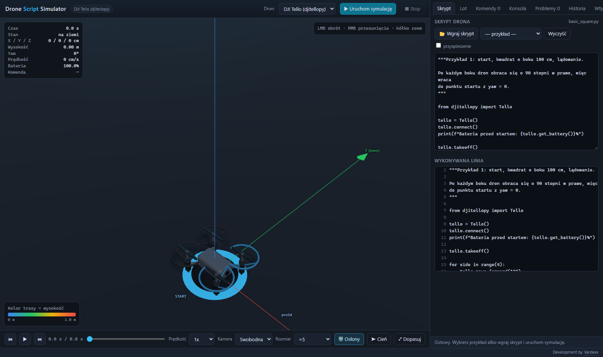
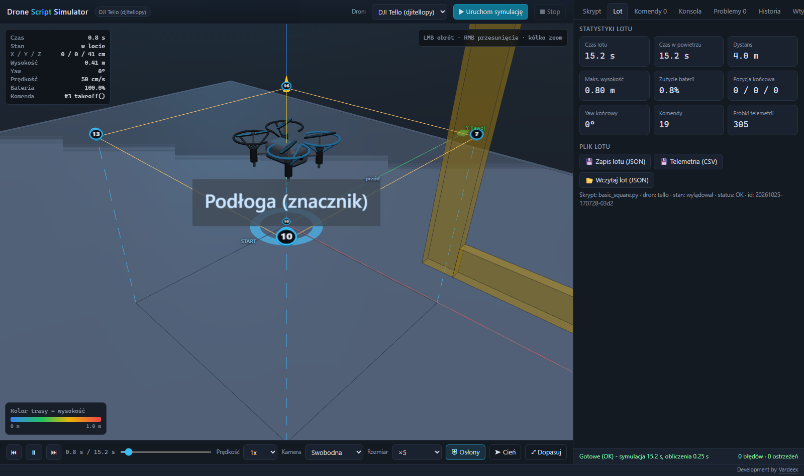
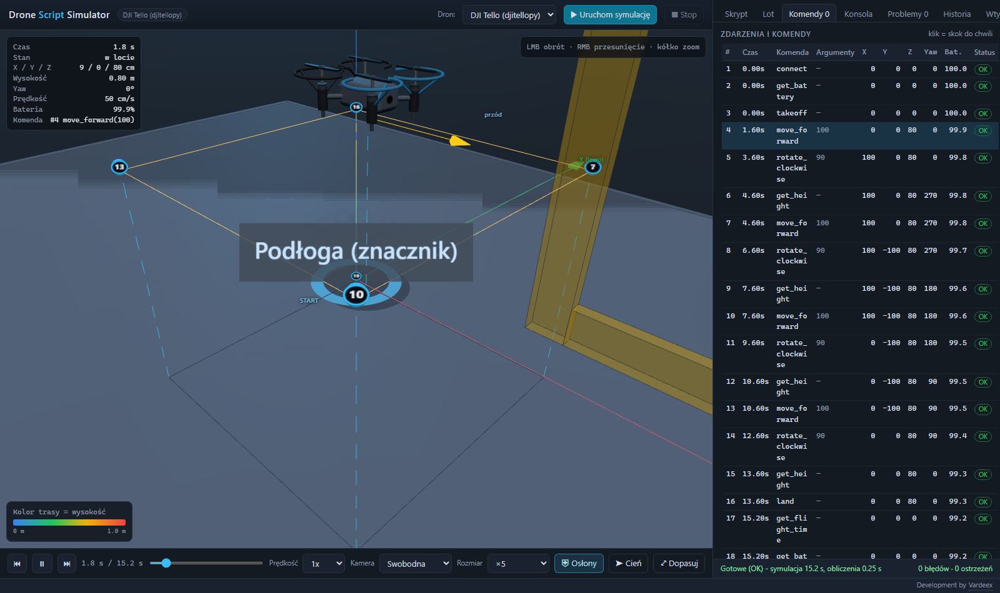
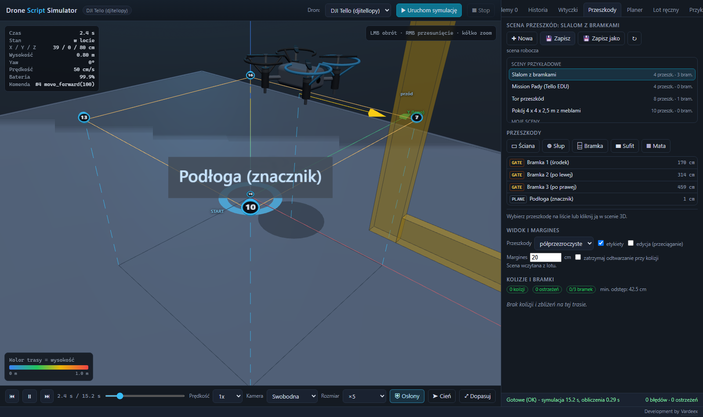
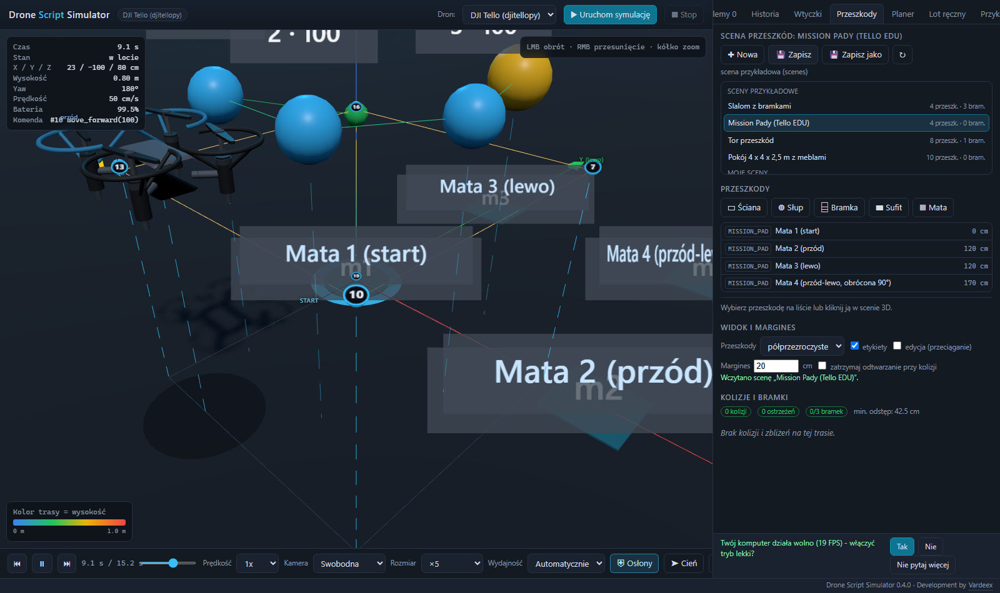
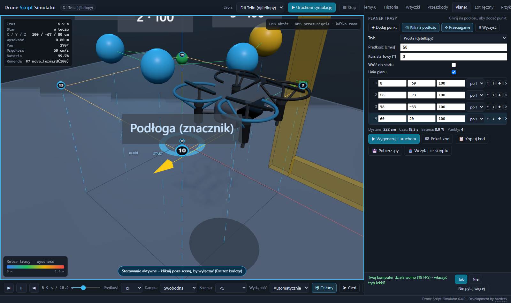
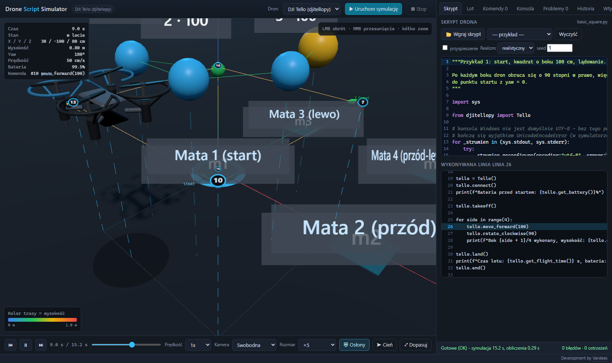
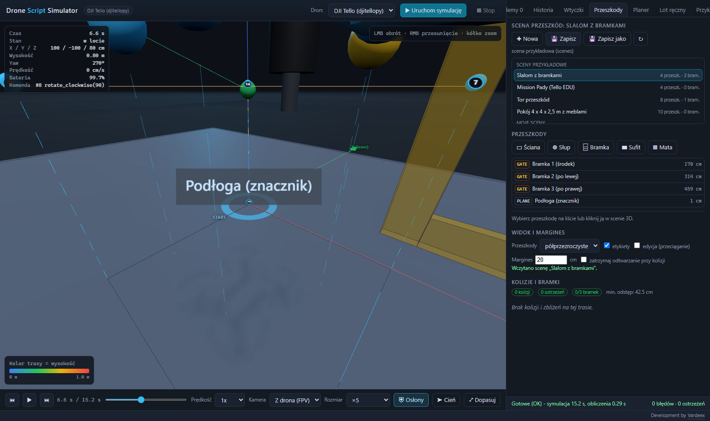
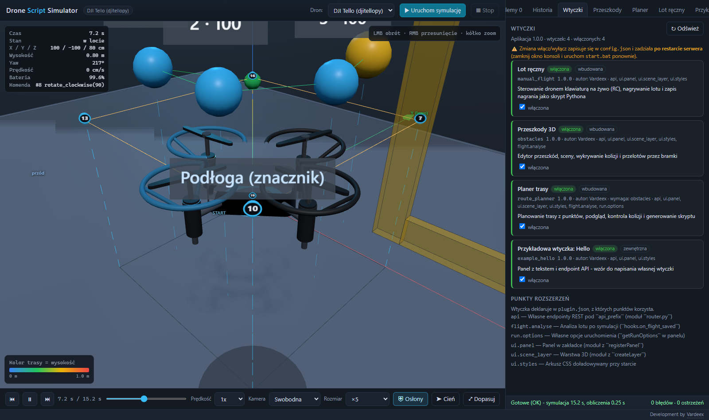

# Poradnik użytkownika

Przewodnik dla osoby, która **pierwszy raz** uruchamia Drone Script Simulator.
Wszystko po polsku, krok po kroku - od instalacji Pythona do pierwszego lotu,
a na końcu przejście na prawdziwego drona Tello.

> Nie znasz pojęć? Na końcu jest [słowniczek](#słowniczek).

## Spis treści

1. [Instalacja na czystym Windows](#1-instalacja-na-czystym-windows) · [gotowa paczka (bez instalacji)](#10-najprościej-gotowa-paczka-bez-instalowania-pythona)
2. [Pierwszy lot w symulatorze](#2-pierwszy-lot-w-symulatorze)
3. [Przeszkody: edytor, sceny, kolizje i bramki](#3-przeszkody-edytor-sceny-kolizje-i-bramki) · [maty Mission Pad](#36-maty-tello-edu-mission-pads)
4. [Planer trasy](#4-planer-trasy)
5. [Biblioteka dronemoves](#5-biblioteka-dronemoves)
6. [Przejście na prawdziwego Tello](#6-przejście-na-prawdziwego-tello) · [tryb realistyczny](#66-tryb-realistyczny---po-co-i-czego-się-spodziewać)
7. [Kamera z drona (FPV)](#7-kamera-z-drona-fpv)
8. [Wtyczki](#8-wtyczki)
9. [Słowniczek](#słowniczek)

---

## 1. Instalacja na czystym Windows

Potrzebujesz: Windows 10/11, ok. 1 GB miejsca na dysku, przeglądarki
(Edge, Chrome, Opera albo Firefox). **Nie** potrzebujesz konta, internetu po
instalacji, ani prawdziwego drona.

### 1.0. Najprościej: gotowa paczka (bez instalowania Pythona)

Jeśli nie chcesz instalować Pythona ani niczego ustawiać w systemie:

1. Wejdź na [github.com/Vardeex/drone-script-sim/releases](https://github.com/Vardeex/drone-script-sim/releases).
2. Pobierz `DroneSim-portable-<wersja>-win64.zip`.
3. **Rozpakuj cały ZIP** do dowolnego katalogu (np. `D:\DroneSim`). Nie kopiuj
   pojedynczych plików z podglądu archiwum - program potrzebuje całego katalogu
   `python\`.
4. Kliknij dwa razy `start.bat`. Przeglądarka otworzy się na
   `http://127.0.0.1:8765/`.

Nic nie jest instalowane w systemie: Python 3.11 i biblioteki są w katalogu
`python\` w rozpakowanej paczce. Usunięcie programu = skasowanie katalogu.
Jeśli port 8765 jest zajęty, ustaw inny przed uruchomieniem:

```bat
set PORT=9000
start.bat
```

Pozostałe sekcje opisują instalację ze źródeł (dla osób, które chcą zmieniać
kod). Jeśli korzystasz z gotowej paczki, możesz przejść od razu do
[rozdziału 2](#2-pierwszy-lot-w-symulatorze).

### 1.1. Zainstaluj Pythona 3.11 (lub nowszego)

1. Wejdź na [python.org/downloads](https://www.python.org/downloads/windows/).
2. Pobierz instalator **Windows installer (64-bit)**, np. 3.11.x albo 3.12.x.
3. Uruchom instalator i **zaznacz na dole „Add python.exe to PATH”** -
   to najczęstsza przyczyna problemów.
4. Kliknij „Install Now” i poczekaj do końca.

Sprawdzenie: otwórz **Wiersz polecenia** (`Win+R` → `cmd` → Enter) i wpisz:

```bat
python --version
```

Powinno pokazać `Python 3.11.x` (albo nowszy). Jeśli widzisz błąd - patrz
[typowe problemy](#15-typowe-problemy-przy-instalacji).

### 1.2. Pobierz projekt

**Wariant A - ZIP (prostszy):**

1. Wejdź na `https://github.com/Vardeex/drone-script-sim`.
2. Zielony przycisk **Code** → **Download ZIP**.
3. Rozpakuj np. do `D:\DroneSim` (unikaj `C:\Program Files` - tam brakuje
   uprawnień, a ścieżka z polskimi znakami i spacjami też bywa problemem).

**Wariant B - git (jeśli masz Gita):**

```bat
git clone https://github.com/Vardeex/drone-script-sim.git D:\DroneSim
```

Po rozpakowaniu w `D:\DroneSim` powinny być m.in. `setup.bat`, `start.bat`,
`app\`, `examples\`.

### 1.3. Uruchom `setup.bat`

Kliknij dwukrotnie **`setup.bat`** w katalogu projektu (albo w wierszu polecenia):

```bat
cd /d D:\DroneSim
setup.bat
```

Skrypt robi trzy rzeczy:

1. sprawdza Pythona (wymaga 3.11+),
2. tworzy środowisko wirtualne `.venv` w katalogu projektu
   (wszystko zostaje **na dysku projektu**, nic nie idzie do systemu),
3. instaluje zależności z `requirements.txt` - **w tym bibliotekę `dronemoves`
   z katalogu `lib/dronemoves`** (instalacja edytowalna, więc skrypty w symulatorze
   mają `from dronemoves import Pilot`; prawdziwe `djitellopy` **nie** jest
   instalowane - sandbox podstawia własny mock).

Na końcu zobaczysz `Gotowe. Uruchom start.bat`.

### 1.4. Uruchom `start.bat`

Kliknij dwukrotnie **`start.bat`**. Otworzy się okno konsoli (serwer) i po
~3 sekundach przeglądarka z adresem `http://127.0.0.1:8765/`.
Okno konsoli **musi zostać otwarte** - zamknięcie zatrzymuje serwer.

Gdy serwer już działa, drugie `start.bat` tylko otworzy przeglądarkę
(nie uruchomi drugiego procesu).

### 1.5. Typowe problemy przy instalacji

| Objaw | Przyczyna | Rozwiązanie |
|---|---|---|
| `python` nie jest rozpoznawany | Python bez PATH | Zainstaluj ponownie z „Add python.exe to PATH” albo `set PYTHON_EXE=C:\Users\<Ty>\AppData\Local\Programs\Python\Python311\python.exe` i `setup.bat` |
| `BLAD: Nie znaleziono Pythona 3.11+` | masz 3.9/3.10 albo inny `python` w PATH | Ustaw `PYTHON_EXE` jak wyżej (wskazując 3.11+/3.12+) |
| `BLAD: instalacja zaleznosci nie powiodla sie` | brak internetu, firewall, antywirus | Sprawdź internet, wyłącz na chwilę antywirus, ponów `setup.bat` |
| `ModuleNotFoundError: No module named 'dronemoves'` w skrypcie | środowisko powstało bez biblioteki z `lib/dronemoves` (starsze `setup.bat`) | Uruchom `setup.bat` ponownie albo `.venv\Scripts\python.exe -m pip install -r requirements.txt` |
| Konsola miga i znika | błąd przed `pause` | Uruchom `setup.bat` z wiersza polecenia (`cmd`), nie kliknięciem |
| `Serwer juz dziala` za każdym razem, a strona się nie otwiera | inny program na porcie 8765 | Zamknij program albo zmień `set "PORT=8765"` w `start.bat` na np. `8766` |
| Strona biała, w konsoli F12 błąd WebGL | karta graficzna/stery w przeglądarce | Włącz akcelerację sprzętową w przeglądarce, zaktualizuj sterownik GPU, spróbuj innej przeglądarki |
| „Nie można uruchomić skryptu, ponieważ uruchamianie skryptów jest wyłączone” | polityka PowerShell | Użyj `cmd` zamiast PowerShell albo `powershell -ExecutionPolicy Bypass` |

---

## 2. Pierwszy lot w symulatorze

Po `start.bat` zobaczysz: po lewej **scenę 3D**, u góry pasek z przyciskami,
po prawej **panel z zakładkami**.



*Zrzut: `docs/poradnik/01-start.png` - scena 3D po lewej, edytor skryptu po prawej.*

### 2.1. Wgraj przykład

1. W zakładce **Skrypt** rozwiń listę **„— przykład —”**.
2. Wybierz `basic_square` (albo `rc_control`, `climb_and_rotate`).
3. Kod pojawi się w edytorze. Możesz go zmienić - to zwykły Python.

Dostępne przykłady:

| Plik | Co pokazuje |
|---|---|
| `basic_square` | kwadrat w powietrzu (`go_xyz_speed`) |
| `climb_and_rotate` | wznoszenie i obroty |
| `rc_control` | sterowanie RC (`send_rc_control` + `time.sleep`) |
| `obstacles_demo` | slalom przez bramki |
| `obstacles_crash` | kolizja z bramką (celowy błąd) |
| `error_out_of_range` | celowy błąd: parametr poza zakresem |
| `no_takeoff` | celowy błąd: komenda bez `takeoff()` |

Ostatnie dwa są **celowo błędne** - mają pokazać, jak aplikacja raportuje
problemy.

### 2.2. Uruchom

Kliknij **▶ Uruchom symulację** (albo `Ctrl+Enter`). Skrypt wykonuje się
w osobnym procesie z podstawionym symulatorem - **nic nie łączy się z siecią**.



*Zrzut: `basic_square` po locie - dron w powietrzu, trasa i znaczniki komend,
po prawej statystyki lotu (15,2 s, 4,0 m, 0,8 % baterii).*

Po zakończeniu dron lata **w odtwarzaniu** (można przewijać), a lot zapisuje
się w **Historii**.

### 2.3. Odtwarzanie

| Element | Co robi |
|---|---|
| ▶ / ⏸ (spacja) | odtwarzanie / pauza |
| ⏮ / ⏭ (← / →) | poprzednia / następna komenda |
| suwak czasu | skok do dowolnego momentu |
| lista **Prędkość** | 0.25× do 8× |
| lista **Kamera** | swobodna / śledząca / z góry |
| ⤢ Dopasuj | kadr na całą trasę |

**Mysz w scenie:** lewy przycisk = obrót kamery, prawy = przesunięcie,
kółko = zoom.

### 2.4. Tabele i panele



*Zrzut: zakładka „Komendy” - każdy wiersz to komenda, klik przenosi do tej
chwili lotu.*

* **Komendy** - każda komenda z czasem, argumentami, pozycją X/Y/Z, yaw, baterią
  i statusem. Klik w wiersz = skok do tej chwili. Manewry biblioteki
  `dronemoves` są zwinięte w jeden wiersz (`◆ forward 100cm`).
* **Konsola** - `stdout`/`stderr` skryptu (twoje `print`).
* **Problemy** - błędy i ostrzeżenia z numerem linii; klik przenosi do linii
  w podglądzie kodu.
* **Lot** - statystyki (czas, dystans, maks. wysokość, zużycie baterii,
  pozycja końcowa) + eksport: **JSON** (cały lot), **CSV** (telemetria).
  „📂 Wczytaj lot (JSON)” przywraca zapisany lot.
* **Historia** - lista zapisanych lotów, klik wczytuje lot do odtwarzania.
* **Wtyczki** - lista rozszerzeń i ich stan (patrz [sekcja 7](#7-wtyczki)).

### 2.5. Co widzisz w scenie 3D

* model drona (korpus, ramiona, wirniki), cień, osłony śmigieł,
* podłoże z siatką 1 m i osie X/Y/Z, znacznik startu,
* **trasę** kolorowaną wysokością (legenda na dole) z pionowymi liniami
  do podłoża,
* znaczniki komend z numerem - kliknięcie pokazuje dymek z argumentami,
  pozycją i czasem.

### 2.6. Problemy w pierwszym locie

| Objaw | Przyczyna | Rozwiązanie |
|---|---|---|
| „Brak komend - uruchom skrypt” | lot się nie wykonał | sprawdź zakładkę **Problemy** |
| błąd `NameError: Tello is not defined` | brak importu | dodaj `from djitellopy import Tello` |
| `RuntimeError`/ostrzeżenie „dron nie jest w powietrzu” | komenda przed `takeoff()` | najpierw `tello.takeoff()` |
| `ValueError: x out of range` | parametr poza limitami Tello | patrz tabela limitów niżej |
| lot kończy się po 60 s | limit czasu sandboxu | skróć skrypt albo zwiększ limit w żądaniu |
| dron „przeskakuje” | brak `time.sleep` po `send_rc_control` | RC działa tylko podczas snu |

Limity Tello (symulator ich pilnuje): odległość 20-500 cm, `rc` w zakresie
-100..100, obrót 1-360°, prędkość 10-100 cm/s, wysokość 10-500 cm.

| Ścieżka z polskimi znakami | niektóre biblioteki | Przenieś projekt do ścieżki bez znaków diakrytycznych, np. `D:\DroneSim` |

---

## 3. Przeszkody: edytor, sceny, kolizje i bramki

Zakładka **Przeszkody** (wtyczka `obstacles`) odpowiada na pytanie: **czy
skrypt rozbiłby drona?** Przeszkody **nie zmieniają lotu** - dron nie odbija
się i nie zatrzymuje; aplikacja tylko pokazuje, co by się stało.



*Zrzut: zakładka „Przeszkody” - edytor scen, kształty, margines i lista kolizji.*

### 3.1. Sceny

* **Scena** = plik JSON z listą przeszkód (`scenes/*.json`). Wbudowane:
  `obstacle_course`, `gate_slalom`, `room_with_furniture`.
* **Twoje sceny** zapisujesz w `scenes/user/` (ten katalog jest w `.gitignore`,
  więc nie trafi do repozytorium).
* „✚ Nowa” tworzy pustą scenę 4 × 4 × 2,5 m. „💾 Zapisz” / „💾 Zapisz jako”
  zapisuje, „↻” odświeża listę.

### 3.2. Dodawanie przeszkód

| Przycisk | Kształt | Do czego |
|---|---|---|
| ▭ Ściana | prostopadłościan | ściany, bloki |
| ◍ Słup | walec | drzewa, słupy |
| ⌸ Bramka | rama z otworem | przelot (bramka) |
| ▬ Sufit | płaszczyzna | ograniczenie wysokości (tylko widok) |
| ▦ Mata | mata Tello EDU | Mission Pad 1-8 (wykrywanie kamerą dolną) |

Po zaznaczeniu przeszkody w liście (albo kliknięciu w scenie 3D) w edytorze
ustawiasz nazwę, pozycję X/Y/Z, rozmiar, obrót. Zaznaczona przeszkoda daje się
przeciągać w scenie („edycja (przeciąganie)”), a Shift + przeciąganie zmienia
wysokość.

### 3.3. Kolizje, zbliżenia, bramki

Po uruchomieniu skryptu aplikacja liczy na **całej telemetrii**:

* **kolizje** - dron wchodzi w bryłę przeszkody (czerwone znaczniki),
* **zbliżenia** - dystans mniejszy niż **margines** (domyślnie 20 cm),
* **przeloty przez bramki** - czy dron przeleciał przez otwór bramki.

Wyniki są w sekcji „Kolizje i bramki”, na trasie w 3D i w zapisanym locie
(klucz `obstacles`).

### 3.4. Widok

* **Przeszkody**: półprzezroczyste / pełne / ukryte,
* **etykiety** - nazwy przy przeszkodach,
* **zatrzymaj odtwarzanie przy kolizji** - odtwarzanie pauzuje na pierwszej
  kolizji (wygodne przy analizie).

### 3.5. Przykład

Wgraj `examples/obstacles_demo.py` i uruchom - slalom przez 3 bramki:
3/3 bramki, 0 kolizji. Potem `examples/obstacles_crash.py` - za mały zjazd
w bok przed bramką 2 daje kolizję z ramą.

### 3.6. Maty Tello EDU (Mission Pads)

Przycisk **▦ Mata** dodaje matę, którą Tello EDU rozpoznaje kamerą dolną.
Ustaw **numer 1-8**, pozycję (mata leży na podłodze) i obrót - obrót ma
znaczenie, bo komendy `*_mid` liczą pozycję w układzie maty. Gotowy zestaw
czterech mat to scena **`mission_pads`**.

W skrypcie: `tello.enable_mission_pads()`, potem `tello.get_mission_pad_id()`
(numer albo **-1**) i `tello.go_xyz_speed_mid(x, y, z, speed, mid)`.
Dron widzi matę, gdy jest nie dalej niż 30 cm od jej środka i na 30-120 cm
nad nią - to **założenia modelu**, nie zmierzone wartości z drona.
Przykład: `examples/mission_pads_demo.py` (przelot 1 → 2 → 1 → 3 → 4).



*Zrzut: scena `mission_pads` - cztery maty na podłodze (w scenie 3D widać ich
numery), po prawej lista przeszkód z numerami mat.*

## 4. Planer trasy

Zakładka **Planer** (wtyczka `route_planner`) buduje trasę z punktów
i generuje gotowy skrypt.



*Zrzut: planer z czterema punktami - w 3D widać trasę, po prawej listę punktów,
dystans, czas i zużycie baterii.*

### 4.1. Punkty

* **✚ Dodaj punkt** - kolejny punkt 100 cm dalej od poprzedniego,
* **Klik na podłożu** - klik w scenie 3D dodaje punkt w tym miejscu,
* wysokość nowego punktu dziedziczy poprzedni (startowo 100 cm),
* lista punktów: edycja X/Y/Z (cm), kurs nosa (`po torze`, `stały kurs`,
  `na punkt`, `na start`), kolejność (↑/↓), wstawianie (✚), usuwanie (✕),
* w scenie 3D: zaznaczanie i przeciąganie punktów (Shift = wysokość).

### 4.2. Podgląd

Po każdej zmianie panel liczy dystans, czas lotu, zużycie baterii i pokazuje
problemy: przekroczenie limitów Tello, kolizje z aktywną sceną przeszkód,
ostrzeżenia o odchyleniu trybu „płynna”.

### 4.3. Tryby generowania

| Tryb | Biblioteka | Kiedy |
|---|---|---|
| **Prosta** (domyślny) | `djitellopy` | dokładny, przewidywalny (`go_xyz_speed` + `rotate_*`) |
| **Płynna** (eksperymentalny) | `dronemoves` | gładkie łuki; może odstawać od punktów, więc panel ostrzega |

### 4.4. Generowanie i uruchamianie

* **▶ Wygeneruj i uruchom** - kod trafia do edytora i startuje symulację,
* **⌨ Pokaż kod** - podgląd bez uruchamiania,
* **📋 Kopiuj kod** / **💾 Pobierz .py** - do użycia poza aplikacją,
* **📥 Wczytaj ze skryptu** - odczytuje trasę z bloku `dronesim-route`
  w skrypcie (trasa jest zapisywana razem z lotem).

### 4.5. Przykład wygenerowanego kodu

```python
from djitellopy import Tello

tello = Tello()
tello.connect()
tello.takeoff()

tello.go_xyz_speed(100, 0, 20, 50)      # punkt 1: 100 cm przód, 20 cm wyżej
tello.rotate_clockwise(90)
tello.go_xyz_speed(100, 0, 0, 50)       # punkt 2: 100 cm po nowym kursie
tello.land()
```


---

## 5. Biblioteka dronemoves

`dronemoves` daje **płynne manewry** (rozpędzanie, jazda, hamowanie) zamiast
skokowych `go_xyz_speed`. Ten sam kod działa w symulatorze i na prawdziwym
dronie.

### 5.1. Instalacja

W symulatorze jest już dostępna (projekt podłącza ją sam). Osobno:

```bat
pip install dronemoves           # samo API
pip install "dronemoves[tello]"  # + djitellopy dla prawdziwego Tello
```

W aplikacji **nie musisz jej instalować** - `setup.bat` robi to za Ciebie
(`requirements.txt` zawiera `-e ./lib/dronemoves`), a skrypty w sandboxie ją widzą.
Powyższe polecenia przydają się, gdy używasz biblioteki w **własnym** projekcie,
poza symulatorem.

### 5.2. Podstawy

```python
from djitellopy import Tello
from dronemoves import Pilot

tello = Tello()
tello.connect()
tello.takeoff()
tello.move_up(50)

with Pilot(tello, speed=40, max_height_cm=200, max_radius_cm=300,
           min_battery=30) as pilot:
    pilot.forward(100)          # 100 cm do przodu
    pilot.turn(90, radius=80)   # łuk w PRAWO (dodatni kąt = w prawo)
    pilot.hover(2)              # zawis 2 s

tello.land()
```

Zawsze używaj `with Pilot(...)` - przy wyjątku biblioteka wysyła
`rc(0,0,0,0)` i ląduje (bo `land_on_exit=True`).

### 5.3. Manewry

| Metoda | Co robi |
|---|---|
| `forward(dystans_cm)` | prosto do przodu, płynnie |
| `turn(kąt, radius=80)` | łuk (**+ = w prawo**) |
| `arc(kąt, radius=100, direction=None)` | łuk z wymuszoną stroną |
| `circle(radius=100, direction="right", face="tangent")` | pełne okrążenie |
| `orbit(radius=120)` | krążenie z nosem do środka |
| `slalom(gates=4, spacing=100, width=60)` | slalom przez bramki |
| `figure_eight(radius=80)` | ósemka |
| `spiral(radius=100, height=100, turns=2)` | wznoszenie po spirali |
| `path([(x, y, z), ...], smooth=True)` | trasa przez punkty **względne** |
| `hover(sekundy)` | zawis |
| `sequence([...])` | kilka manewrów jako jeden ruch |
| `preview(manewr)` | zaplanowany tor **bez lotu** |
| `position()`, `yaw` | szacowana pozycja i kurs |

Punkty w `path` są **względne wobec pozycji i kursu drona**:
`(100, 0, 0)` = 100 cm przed nosem, `(0, 100, 0)` = 100 cm w lewo,
`(0, 0, 20)` = 20 cm wyżej.

### 5.4. `safe_start` i preflight

```python
from dronemoves import Pilot, PreflightError, preflight, safe_start

print(preflight(tello, plan_eta_s=120))   # raport: OK / OSTRZEŻENIA / BŁĘDY
pilot = Pilot(tello, speed=40)
try:
    safe_start(tello, pilot=pilot, confirm=True, countdown_s=3)
except PreflightError as exc:
    print("Start wstrzymany:", exc)
```

Preflight sprawdza baterię (błąd < 50 %, ostrzeżenie < 60 %), temperaturę
(błąd ≥ 80 °C), Wi-Fi, czy dron odpowiada i czy stoi na ziemi.

### 5.5. `return_home` i `watch_battery`

```python
pilot.set_geofence(max_height_cm=250, max_radius_cm=300)
pilot.watch_battery(min_pct=25, action="return_home")   # nadzór w tle

pilot.forward(150)
pilot.turn(90, radius=60)
pilot.forward(100)
pilot.return_home()      # wraca do punktu startu
pilot.safe_land()        # stop, zawis, lądowanie
```

* **`return_home`** - wraca do `(0, 0)` po szacowanej pozycji (bez GPS!),
  kończy typowo w kilku cm od startu.
* **`watch_battery`** - wątek w tle: po spadku baterii poniżej progu przerywa
  lot, wraca do startu (albo tylko ląduje) i kończy pracę. Pozycję po powrocie
  odczytasz przez `pilot.watch_position`.

### 5.6. Geofence

```python
pilot.set_geofence(max_height_cm=250, max_radius_cm=300,
                   box_cm=(-200, 200, -200, 200))
```

Przed **każdym** manewrem sprawdzana jest cała zaplanowana trajektoria
(wysokość nad ziemią, odległość od startu, opcjonalny prostokąt X/Y).
Naruszenie = `SafetyError`, manewr **nie startuje**.

### 5.7. Błędy

| Wyjątek | Kiedy |
|---|---|
| `ManeuverError` | złe parametry / niemożliwy manewr |
| `SafetyError` | geofence, bateria, wysokość - manewr wstrzymany |
| `PreflightError` | `safe_start` odmówił startu |

Szczegóły i pełne API: [lib/dronemoves/README.md](../lib/dronemoves/README.md).

---

## 6. Przejście na prawdziwego Tello

Symulator jest po to, żeby **nie rozbić drona**. Różnice są realne - czytaj
przed pierwszym lotem.

### 6.1. Zasady bezpieczeństwa (przeczytaj wszystkie)

1. **Duża, pusta przestrzeń** - minimum 3 × 3 m, brak ludzi, zwierząt,
   lamp sufitowych i kabli w zasięgu.
2. **Nisko** - pierwsze testy do 1,5 m (`max_height_cm`), na wysokości 50-80 cm
   nad podłogą.
3. **Pełna bateria** - startuj powyżej 80 %, ustaw `min_battery=30`.
4. **Mała prędkość** - `speed=20` do 30 cm/s na pierwsze loty.
5. **Zawsze `with Pilot(...)`** - gwarantuje stop i lądowanie przy błędzie.
6. **Ustaw limity** - `max_height_cm`, `max_radius_cm`, `set_geofence`.
   Bez limitu program poleci tak daleko, jak pozwoli sygnał.
7. **Trzymaj dłoń na „Stop”** w aplikacji / gotowy `Ctrl+C`.
8. **Nie lataj w słońcu i wietrze** - Tello waży 80 g, wiatr go znosi.
9. **Osłony śmigieł** - załóż, jeśli masz (chronią przy kontakcie ze ścianą).
10. Testuj **jeden manewr na raz** - `forward(50)` i ląduj, potem więcej.

### 6.2. Połączenie z dronem

1. Włącz Tello, poczekaj na diodę.
2. Połącz komputer z Wi-Fi drona (`TELLO-XXXXXX`).
3. W aplikacji wybierz adapter `DJI Tello` (lista u góry).

> Aplikacja (symulator) **nigdy** nie łączy się z dronem - sandbox blokuje
> sieć. Kod z planera kopiujesz i uruchamiasz sam w swoim Pythonie.

### 6.3. Kalibracja (`calibrate.py`)

Tello nie ma GPS, a jego sterowanie RC jest „przybliżone”. `calibrate.py`
mierzy realne zachowanie drona i zapisuje profil kalibracji
(`CalibrationProfile`), którego używa `Pilot`:

* prędkość rzeczywista przy danym wychyleniu,
* opóźnienie reakcji (inercja),
* dryf w zawisie.

Kalibracja wymaga taśmy mierniczej i pustej przestrzeni. Bez kalibracji
biblioteka używa profilu `TELLO_PROFILE` (założenia z dokumentacji, nie pomiary).

### 6.4. Symulator ↔ rzeczywistość

| Aspekt | Symulator | Prawdziwy Tello |
|---|---|---|
| Tor lotu | idealny (plan 1:1) | dryf 5-20 cm na 100 cm drogi |
| Kurs nosa | dokładny | błąd 2-5° |
| Zawis | stabilny | lekko dryfuje |
| Bateria | 0,05 %/s | zależy od manewrów i wiatru |
| Wiatr / przeciąg | brak | wpływa na wszystko |
| Kolizje | tylko raport | realne uszkodzenia |
| Latencja | brak | 20-100 ms |
| Przeszkody | rysowane | trzeba je widzieć |

**Wniosek:** traktuj symulację jako test *logiki* skryptu (czy manewry mają
sens, czy nie przekraczasz limitów), a nie gwarancję toru lotu.

### 6.5. Checklista pierwszego prawdziwego lotu

- [ ] bateria > 80 %, osłony założone
- [ ] pusta przestrzeń 3 × 3 m, nikt w środku
- [ ] skrypt testuje **jeden** `forward(50)` i `land()`
- [ ] `Pilot(speed=20, max_height_cm=150, max_radius_cm=200, min_battery=30)`
- [ ] geofence ustawiony
- [ ] wiesz, jak przerwać (`Ctrl+C`, `Stop`, wyłączenie drona przyciskiem)
- [ ] dłoń nad „Stop”, oczy na dronie (nie na ekranie)
- [ ] w symulatorze włączony tryb **realistyczny** i skrypt nadal bezpieczny

### 6.6. Tryb realistyczny - po co i czego się spodziewać

Idealny symulator pokazuje, że `return_home()` wraca dokładnie w miejsce startu.
Prawdziwy Tello dryfuje (kilka cm/s), a jego czujniki kłamią o kilka cm i stopni.
Przełącznik **Realizm: realistyczny** w nagłówku edytora włącza:

* dryf poziomy 2-6 cm/s (losowy kierunek zmieniany co sekundę),
* szum `get_height()` ±2 cm i `get_yaw()` ±1,5°,
* opóźnienie reakcji na RC 100 ms,
* niedokładność `move_*` ±5 % odległości.

**To założenia modelu, nie pomiary.** Pole **seed** daje powtarzalność - ten sam
seed = ten sam lot, więc błąd można odtworzyć. Zmierzone w symulatorze: przy
trybie realistycznym `return_home` kończy 2,9-11,3 cm od startu (średnio 7,8 cm),
podczas gdy w trybie idealnym jest to poniżej 1 cm. Wniosek praktyczny: zapas
bezpieczeństwa przy prawdziwym dronie licz na kilkanaście centymetrów, nie na
centymetry. Spotkanie z matą Mission Pad również wymaga poprawki - realnie
dolot w promień 30 cm nie zawsze się udaje.

Tryb idealny (domyślny) liczy lot dokładnie tak jak wcześniej.



*Zrzut: przełącznik „Realizm: realistyczny” i pole seed w nagłówku edytora;
w statystykach widać, że dron nie jest dokładnie tam, gdzie przewidywała trasa.*

## 7. Kamera z drona (FPV)

Lista **Kamera** (nad osią czasu) ma tryb **Z drona (FPV)** - obraz z kamery
w nosie modelu, z polem widzenia **82,6°** (tyle podaje specyfikacja DJI Tello;
pozostałe tryby mają 50°). Kamera jedzie z dronem w każdej klatce, więc działa
przy odtwarzaniu i przy przewijaniu suwakiem. W tym trybie mysz nie obraca
kamerą (steruje nią dron) - wróć do „Swobodna”, żeby rozglądać się po scenie.

Wskazówka: do przeglądania długiej trasy użyj „Śledząca”; FPV najlepiej pokazuje
przelot przez bramkę albo nad matą.



*Zrzut: widok z drona (tryb FPV) w locie `basic_square` - scena `gate_slalom`
widziana z perspektywy drona.*

---

## 8. Wtyczki

Zakładka **Wtyczki** pokazuje wszystkie rozszerzenia aplikacji: nazwę, wersję,
autora, zależności, stan (włączona / wyłączona / błąd) i przełącznik.



*Zrzut: trzy wtyczki (`obstacles`, `route_planner`, `example_hello`), przy
każdej wersja, autor, zależności i punkty rozszerzeń.*

* Przełączenie zapisuje się w `config.json`.
* **Zmiana działa po restarcie serwera** - zamknij okno `start.bat` i uruchom
  `start.bat` ponownie.
* Gdy wtyczka ma błąd (np. zepsuty manifest), zobaczysz komunikat, a reszta
  aplikacji działa normalnie.

Przykładowa wtyczka `example_hello` dodaje zakładkę **Hello** z tekstem
i przyciskiem, który pyta jej API. Własną wtyczkę piszesz wg
[docs/plugins.md](plugins.md).

---

## Słowniczek

| Pojęcie | Znaczenie |
|---|---|
| **skrypt** | plik `.py` z komendami drona (`tello.takeoff()`, `pilot.forward(100)`) |
| **sandbox** | osobny proces, w którym skrypt działa bez dostępu do sieci |
| **mock `djitellopy`** | podstawiona biblioteka - zamiast drona steruje symulatorem |
| **telemetria** | próbki lotu: czas, pozycja, wysokość, kurs, bateria |
| **yaw** | kurs nosa drona (0-360°, dodatni w prawo) |
| **RC** | sterowanie `send_rc_control` (wychylenia -100..100) |
| **manewr** | jedna akcja biblioteki `dronemoves` (`forward`, `turn`, ...) |
| **geofence** | limit obszaru/wysokości, poza który dron nie poleci |
| **preflight** | test przed startem (bateria, temperatura, Wi-Fi, ziemia) |
| **wtyczka** | rozszerzenie aplikacji (`app/features/*` albo `plugins/*`) |

